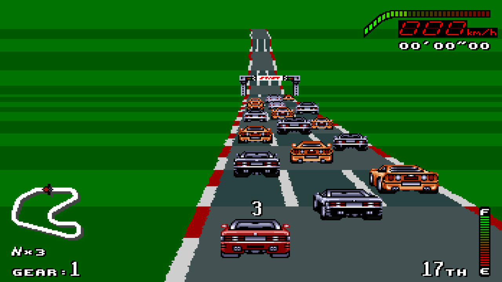

Made by **Vibe Slop Studios**. Top Gear PC TAG.

**You need your own SNES ROMs: Top Gear, Top Gear 2 and/or Top Gear 3000 (USA).** No ROMs are included: each game's graphics, sound and music come from your own copy. Top Gear 3000 also needs the DSP-4 chip's firmware (`dsp4.bin`, 8 KB) from your own cartridge. Unzip, run `topgear-launcher`, choose your files, set the options and press Start.

Downloads:
- **Windows (x64):** `topgear-pc-windows-x64.zip`
- **Linux (x64, experimental):** `topgear-pc-linux-x64.tar.gz`. It's built automatically and hasn't been tested on real Linux machines yet, so it may not be stable. Please report what you find.

What's in it: faithful ports of the three games, plus optional extras that are all off by default. These include widescreen, smooth motion and high frame rate, a ghost car, display filters, TV colours, rumble and button remapping, and in Top Gear and Top Gear 2 auto-save and 2 players side by side (plus Top Gear's full-screen 1-player view). The README has the details.

A fan project, not affiliated with or endorsed by Kemco, Gremlin Graphics or Nintendo.
